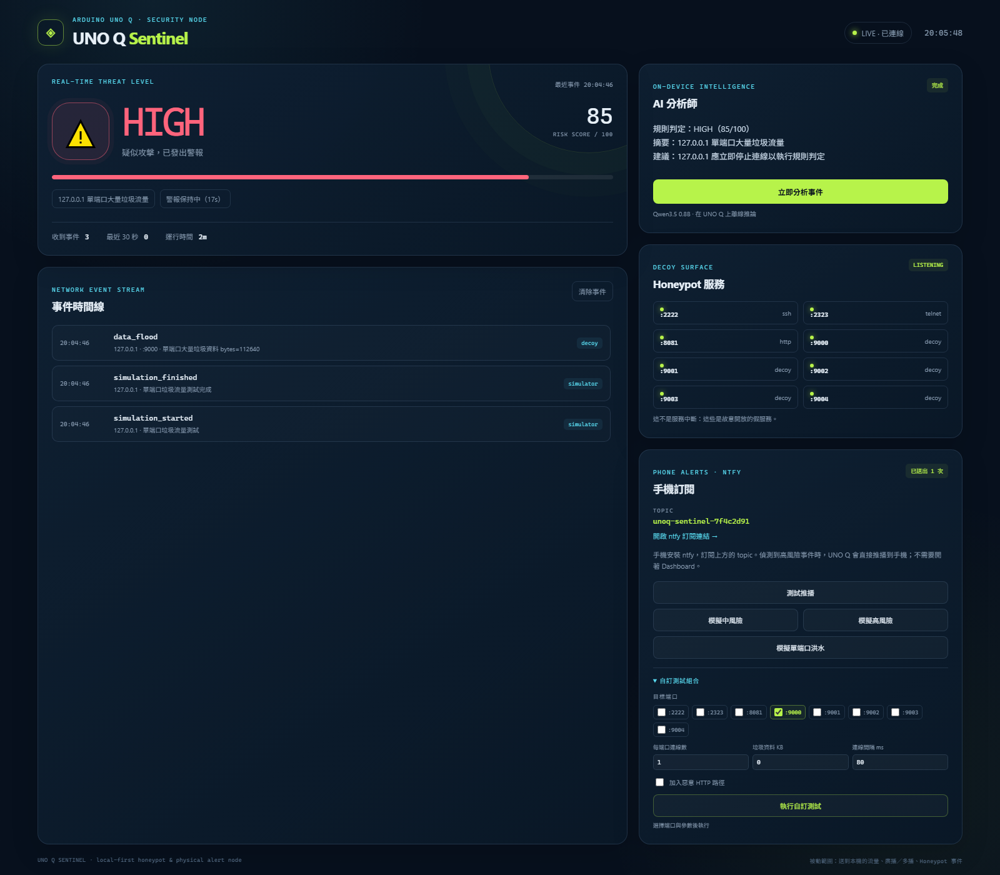
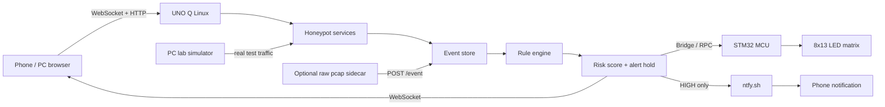

# UNO Q Sentinel

A local-first **AI honeypot and physical network threat monitor** for Arduino UNO Q.

UNO Q runs the dashboard, the small language model, the rule engine, and the
physical LED state. A PC or phone is only the controller/viewer. No camera,
microphone, or additional sensor is required.



## What it does

- Exposes a small set of decoy TCP/HTTP services ("honeypot").
- Collects connection and payload events.
- Detects suspicious behavior with a deterministic rule engine.
- Runs **Qwen3.5 0.8B locally on UNO Q** to turn a batch of events into a
  human-readable incident summary.
- Drives the 8×13 LED matrix over Bridge/RPC:
  - green: normal
  - yellow: medium risk
  - red: high risk
- Sends **HIGH** risk alerts to a phone through **ntfy**.
- Provides a dashboard test lab with presets and a custom combination builder.

The LLM is **not** the detector. The rule engine makes the risk decision first;
the LLM is an analyst/reporting layer.

## Architecture



More detail:

```text
Honeypot TCP/HTTP services
        │ connection / payload events
        ▼
Event queue + rolling windows
        │
        ▼
Rule engine
  ├─ multiple ports
  ├─ repeated SSH attempts
  ├─ malicious HTTP paths
  ├─ same-port connection rate
  └─ single-port data/volume flood
        │
        ├─ LED matrix
        ├─ Web dashboard
        ├─ ntfy phone push (HIGH)
        └─ Qwen3.5 0.8B summary
```

## Features

- Arduino App Lab app using `arduino:web_ui` + `arduino:llm`
- On-device `llamacpp:Qwen3.5-0.8B-Q4_0`
- Honeypot ports:
  - `2222` — fake SSH
  - `2323` — fake Telnet
  - `8081` — fake HTTP
  - `9000`–`9004` — generic decoy TCP
- Rule engine:
  - 3+ ports in 30 seconds → MEDIUM
  - 5+ ports in 30 seconds → HIGH
  - repeated SSH attempts → HIGH
  - known malicious HTTP paths → HIGH
  - high same-port connection rate → MEDIUM/HIGH
  - single-port data flood → HIGH
- 45-second alert hold so the dashboard and LED remain visible long enough for
  the LLM to finish
- Dashboard event timeline and AI analyst card
- ntfy phone subscription
- Dashboard test lab:
  - medium-risk scan
  - high-risk scan + malicious HTTP + SSH
  - single-port flood
  - custom port/connection/payload combination
- Optional privileged raw IPv4/TCP capture sidecar

## Repository layout

```text
unoq_security_tower/
  app.yaml
  python/main.py              honeypot, rules, API, LLM, LED, ntfy
  assets/                     dashboard UI
  sketch/sketch.ino           Bridge/RPC LED matrix driver
  attack_simulator.py         PC lab traffic generator
  capture/
    capture_agent.py          optional raw IPv4/TCP capture
    run_capture.sh            Docker launcher for the capture helper
    README.md
  README.md                   app-level notes
docs/
  dashboard-high-custom.png
  dashboard-medium.png
README.md
THIRD_PARTY_NOTICES.md
.gitignore
```

## Deployment environment

| Component | Requirement |
|---|---|
| Board | Arduino UNO Q with Wi-Fi, App Lab / `arduino-app-cli` |
| Tested App CLI | `0.14.1` |
| Board storage | At least ~1 GB free; first launch downloads the ~507 MB LLM model |
| Board internet | Required for model download and ntfy HTTPS |
| PC | Windows, macOS, or Linux; ADB for USB deployment/forwarding |
| PC Python | Python 3.10+ only for `attack_simulator.py`; uses only the standard library |
| Phone | ntfy app (Android/iOS) for push notifications |
| Network | Board and PC/phone on the same LAN; board needs outbound HTTPS |
| Camera/sensors | **Not required** |
| Optional raw capture | Docker on UNO Q and `NET_RAW` capability |
| Dashboard port | `7000` inside the app; `17000` over ADB forwarding |
| Honeypot ports | `2222`, `2323`, `8081`, `9000`–`9004` |

### Before deploying

- The board must have App Lab installed.
- The default LLM model is downloaded automatically by the `arduino:llm`
  brick. Allow time for the first start.
- The default ntfy topic is a demo topic. Change it before using the project on
  a real network.
- Do not expose the honeypot ports or `/event` API to the public internet. The
  ingest endpoint is intentionally unauthenticated for this lab version.

## Operation steps

### 1. Clone the repository

```bash
git clone https://github.com/sunshine9653240/unoq-sentinel.git
cd unoq-sentinel
```

### 2. Deploy the app to UNO Q

With ADB:

```bash
adb devices -l
adb -s <BOARD_SERIAL> shell "mkdir -p /home/arduino/ArduinoApps"
adb -s <BOARD_SERIAL> push ./unoq_security_tower /home/arduino/ArduinoApps/
```

Or use SCP:

```bash
scp -r ./unoq_security_tower arduino@<BOARD_IP>:/home/arduino/ArduinoApps/
```

### 3. Start the app

```bash
adb -s <BOARD_SERIAL> shell \
  "arduino-app-cli app start /home/arduino/ArduinoApps/unoq_security_tower"
```

Check status and logs:

```bash
adb -s <BOARD_SERIAL> shell "arduino-app-cli app ps"
adb -s <BOARD_SERIAL> shell \
  "arduino-app-cli app logs /home/arduino/ArduinoApps/unoq_security_tower"
```

The first start downloads and loads `Qwen3.5-0.8B-Q4_0`. Wait until the app is
`running` and the dashboard responds.

### 4. Open the dashboard

Same LAN:

```text
http://<BOARD_IP>:7000/
```

USB-only:

```bash
adb -s <BOARD_SERIAL> forward tcp:17000 tcp:7000
```

```text
http://127.0.0.1:17000/
```

### 5. Subscribe the phone to alerts

1. Install the **ntfy** app on the phone.
2. Subscribe to the topic configured in
   `unoq_security_tower/python/main.py` (`NTFY_TOPIC`).
3. Open the dashboard and click **測試推播**.
4. A successful request returns `ok: true` and the dashboard changes to
   **已送出**.

Default demo topic:

```text
unoq-sentinel-7f4c2d91
```

Change `NTFY_TOPIC` before deployment. For a private ntfy server, also change
`NTFY_SERVER`.

The current alert policy is:

- MEDIUM → dashboard and LED only
- HIGH → dashboard, LED, and phone push
- HIGH notifications are rate-limited to one per 60 seconds

### 6. Run a test

From the dashboard:

- **模擬中風險** — three ports
- **模擬高風險** — all ports + SSH + malicious HTTP
- **模擬單端口洪水** — one port + large junk payload
- **自訂測試組合** — choose ports, connections per port, payload KB, delay,
  and optional malicious HTTP path

From a PC on the same LAN:

```bash
python unoq_security_tower/attack_simulator.py --host <BOARD_IP>
```

The simulator uses only Python's standard library. It generates real test
traffic to the honeypot; it does not inject fake dashboard events.

### 7. Optional raw packet capture

The normal App Lab container does not have `CAP_NET_RAW`. The optional helper
runs on the UNO Q host through Docker:

```bash
adb -s <BOARD_SERIAL> shell
cd /home/arduino/ArduinoApps/unoq_security_tower/capture
sh run_capture.sh <BOARD_IP>
```

It uses:

```text
--network host --user 0 --cap-add NET_RAW
```

It captures IPv4/TCP traffic addressed to the board and POSTs event summaries
to `/event`.

This is **not** full-subnet packet capture. In managed Wi-Fi mode the board can
only see traffic to/from itself and broadcast/multicast traffic. For full-LAN
visibility, use a mirrored switch port, router flow export, or a monitor-mode
adapter.

## Custom test API

The dashboard's custom builder calls:

```http
POST /api/simulate-custom
Content-Type: application/json

{
  "ports": [9000, 9001, 9002],
  "connections": 1,
  "payload_bytes": 0,
  "delay_ms": 80,
  "malicious_http": false
}
```

Limits enforced by the backend:

- ports: only exposed honeypot ports
- `connections`: `1–20` per port
- `payload_bytes`: `0–131072`
- `delay_ms`: `0–500`
- `malicious_http`: boolean

## API endpoints

| Method | Path | Purpose |
|---|---|---|
| GET | `/api/state` | Current threat, LLM state, ports, ntfy topic |
| GET | `/api/events` | Recent event stream |
| POST | `/event` | Ingest external router/Syslog/pcap events |
| POST | `/api/reset` | Clear events and return to LOW |
| POST | `/api/simulate` | High-risk preset |
| POST | `/api/simulate-medium` | Medium-risk preset |
| POST | `/api/simulate-flood` | Single-port flood preset |
| POST | `/api/simulate-custom` | Custom test combination |
| POST | `/api/test-notify` | Send an ntfy test |
| POST | `/api/analyze` | Force an LLM analysis |

External event example:

```bash
curl -X POST http://<BOARD_IP>:7000/event \
  -H 'Content-Type: application/json' \
  -d '{"source":"192.168.0.25","service":"router","event":"port_scan","port":22,"detail":"blocked by firewall"}'
```

## Detection scope

This version is intentionally small. It covers:

- multiple destination ports
- repeated SSH attempts
- known malicious HTTP paths
- same-port connection rate
- large payload / single-port volume

It does **not** yet cover:

- UDP/ICMP floods
- slow/distributed scans
- advanced SQLi/XSS/command-injection parsing
- ARP/DHCP/DNS attacks
- full-LAN lateral movement
- authenticated event ingestion

Those require additional telemetry and rules. The rule engine controls the
alert; the LLM is advisory and can be unavailable without breaking detection.

## Troubleshooting

### App is not running

```bash
adb -s <BOARD_SERIAL> shell "arduino-app-cli app ps"
adb -s <BOARD_SERIAL> shell \
  "arduino-app-cli app logs /home/arduino/ArduinoApps/unoq_security_tower"
```

Check that the board has enough free disk and that another App is not occupying
the same ports.

### Dashboard still shows old UI

The assets use cache-busting query strings. Hard-refresh the browser
(`Ctrl + F5` on Windows). 

### No phone notification

- Check that the phone subscribed to the exact topic.
- Click **測試推播**.
- Confirm the board has outbound HTTPS access.
- Check the app log for `ntfy notification sent: 200`.

### Raw capture permission error

Run it through `capture/run_capture.sh`; the helper needs `--user 0` and
`--cap-add NET_RAW`. It is separate from the normal App Lab container.

## Tested environment

- Arduino UNO Q with App CLI `0.14.1`
- `arduino:llm` default `llamacpp:Qwen3.5-0.8B-Q4_0`
- Web dashboard served on port `7000`
- MEDIUM/HIGH simulation, custom port/payload combinations, ntfy HTTP 200,
  and raw capture event ingestion were tested locally.

## Third-party notices

See [THIRD_PARTY_NOTICES.md](THIRD_PARTY_NOTICES.md).

## License

No project-specific license is declared in this repository. Third-party
components retain their original licenses.

